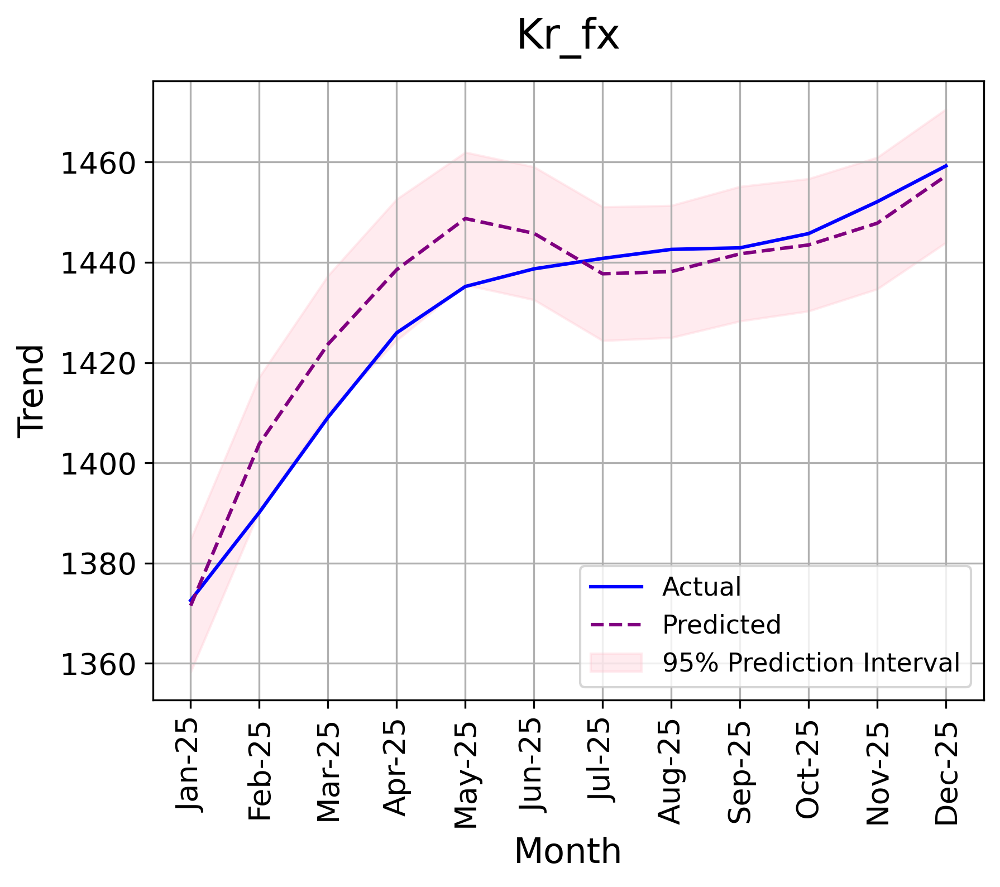
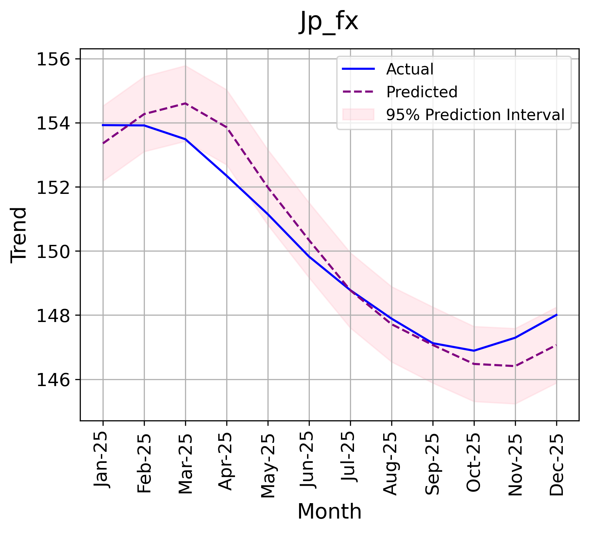
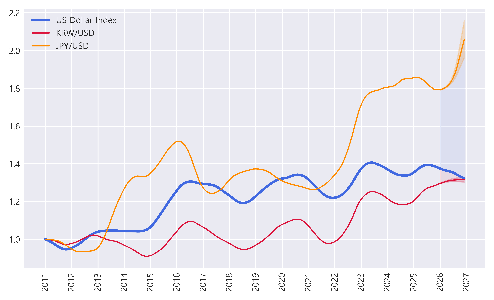

# 경제적 맥락을 반영한 해석 가능한 환율 예측

**B-MTGNN 기반 멀티에이전트 프레임워크** 

---

## 📝 프로젝트 소개

미국·한국·일본의 월별 환율과 거시경제 지표를 하나의 그래프로 묶어 학습하는 **B-MTGNN(Bayesian MTGNN)** 으로 환율을 예측합니다.
예측할 때도 Dropout을 켠 채 여러 번 반복 실행하는 **MC Dropout** 으로 예측값과 95% 신뢰구간을 함께 구합니다.

- 예측 대상: 미국 무역가중 달러지수(US Trade Weighted Dollar Index), 원/달러 환율, 엔/달러 환율
- 입력: 환율·파생 지표·거시경제 지표 33개 변수 (변수 1개 = 그래프 노드 1개)
- 변수 간 연결(인접행렬)은 적응형 그래프 학습 모듈이 데이터에서 직접 학습
- 2025년 12개월로 성능을 검증하고, 2026년 1~12월 환율 경로와 국가 간 환율 격차를 예측

> 전체 프레임워크는 예측 결과를 멀티에이전트(LLM) 시스템이 경제적으로 해석하는 단계까지 포함합니다.
> 이 저장소에는 그중 **B-MTGNN 예측 · 불확실성 추정 · 국가 간 격차 분석** 코드와 결과가 들어 있습니다.

---

## 📊 데이터

- 기간: 2011.01 ~ 2025.12 (월별 180개월)
- 변수: 33개

| 구분 | 변수 | 개수 |
|---|---|:---:|
| 환율 | `us_Trade Weighted Dollar Index`, `kr_fx`, `jp_fx` | 3 |
| 파생 지표 | 수익률 `*_ret`, 1개월 시차 수익률 `*_ret_lag1`, 국가 간 수익률 차이 `*_spread`, 국가 간 상관계수 `corr_*` | 12 |
| 거시경제 | 금리, GDP, CPI, 고용, 실업률, 무역수지 × 미국·한국·일본 | 18 |

- 전처리: 이중 지수평활(Double Exponential Smoothing, α=0.1, β=0.3)
- 데이터 분할: 2025년 데이터는 학습·검증에 쓰지 않도록 고정

| 구간 | 기간 | 길이 |
|---|---|:---:|
| 학습 | 2011.01 ~ 2023.12 | 156개월 |
| 검증 | 2024.01 ~ 2024.12 | 12개월 |
| 테스트 | 2025.01 ~ 2025.12 | 12개월 |

---

## 🧠 모델

- **MTGNN**: 그래프 합성곱(mix-hop)으로 변수 간 관계를, 팽창 합성곱(dilated inception)으로 시간 패턴을 학습하는 다변량 시계열 그래프 신경망
- **B-MTGNN**: MTGNN에 MC Dropout을 더한 베이지안 확장. 예측 단계에서 Dropout을 켠 채 반복 실행해 평균과 95% 신뢰구간(±1.96σ)을 계산
  - 테스트 평가 10회, 2026년 예측 20회 반복

주요 설정 (`train_test.py` 기본 프로필 `triple_050`, 결과는 `Bayesian/hp.txt`)

| 항목 | 값 |
|---|---|
| 입력 길이 | 24개월 |
| 학습률 | 0.00015 |
| Dropout | 0.02 |
| Epoch | 180 |
| 레이어 / GCN depth | 2 / 1 |
| Residual / Skip / End 채널 | 128 / 256 / 1024 |
| 손실 함수 | L1 (예측 대상 3개 변수 기준) |

---

## 📈 결과

### 테스트 (2025.01 ~ 2025.12)

| 예측 대상 | RRSE | RAE |
|---|:---:|:---:|
| 미국 무역가중 달러지수 | 0.516 | 0.414 |
| 원/달러 | 0.337 | 0.331 |
| 엔/달러 | 0.283 | 0.253 |

- RRSE(Root Relative Squared Error)와 RAE(Relative Absolute Error)는 낮을수록 좋으며, 1보다 작으면 평균값으로 예측한 것보다 정확하다는 뜻입니다.
- 값은 `Bayesian/Testing/*_Testing.txt` 기준입니다. (파일에는 RRSE가 `rse`로 적혀 있음)

<p align="center">
  
  
  
</p>
<p align="center">파란 실선: 실제값 · 보라 점선: 예측값 · 분홍 영역: 95% 신뢰구간</p>

### 2026년 예측

<p align="center">
  
</p>

- 2011년 1월 값을 1.0으로 맞춘 정규화 경로이고, 2026년 구간이 예측값입니다.
- 2026년 구간의 음영은 95% 신뢰구간과 국가 간 환율 격차입니다.
- 변수별 예측값은 `Bayesian/forecast/data/`, 국가 간 격차·분기 요약 CSV는 `Bayesian/forecast/gap/`에 있습니다.

---

## 🗂️ 폴더 구조

```
.
├── B-MTGNN/                      # 코드
│   ├── data/
│   │   ├── data.csv              # 원본 월별 데이터 (2011.01~2025.12, 33개 변수)
│   │   ├── sm_data.csv           # 이중 지수평활 데이터 (모델 입력)
│   │   ├── graph.csv             # 사전 정의 그래프
│   │   └── Collecting_date/      # 수집 데이터 (환율·파생 지표, 거시경제 fred_data.csv)
│   ├── net.py, layer.py          # MTGNN 모델, 그래프·시간 합성곱 레이어
│   ├── util.py, trainer.py       # 데이터 로더·정규화, 옵티마이저
│   ├── smoothing.py              # 이중 지수평활
│   ├── train_test.py             # 학습·검증·테스트, 지표·그래프 저장
│   ├── forecast.py               # 2026년 예측, 신뢰구간, 국가 간 격차
│   ├── figure_plot.py            # 정규화 격차 막대그래프
│   ├── train.py, o_util.py, pt_plots.py   # 원본 B-MTGNN 스크립트 (현재 실행 흐름에서는 사용 안 함)
│   └── requirements.txt
└── Bayesian/                     # 결과물
    ├── model.pt, hp.txt          # 학습된 모델, 하이퍼파라미터
    ├── Validation/, Testing/     # 변수별 예측 그래프(.png)·지표(.txt)
    └── forecast/                 # 2026년 예측 (data/, gap/, plots/, pt_plots/)
```

---

### How to Run?

```bash
cd B-MTGNN
pip install -r requirements.txt

python train_test.py    # 학습 → 검증(2024) → 테스트(2025), 모델·지표·그래프 저장
python forecast.py      # 2026년 1~12월 예측, 95% 신뢰구간, 국가 간 격차 CSV
python figure_plot.py   # 정규화 격차 막대그래프 (seaborn 필요: pip install seaborn)
```

- GPU가 있으면 `cuda:0`, 없으면 CPU로 실행됩니다.
- 결과는 저장소 루트의 `AXIS/model/Bayesian/`에 저장되고, `forecast.py`도 이 경로의 `model.pt`를 불러옵니다. 그래서 `train_test.py`를 먼저 실행해야 합니다. 이 저장소의 `Bayesian/` 폴더는 이렇게 만든 결과를 옮겨 둔 것입니다.
- `data/sm_data.csv`는 평활을 마친 상태로 들어 있습니다. `smoothing.py`를 다시 실행하면 날짜·변수명 없이 값만 저장되니 주의하세요.

---

## 🛠️ 사용 기술

Python · PyTorch · NumPy · Pandas · SciPy · scikit-learn · Matplotlib

---

## 🔗 참고

- B-MTGNN 원본 구현: [Cyber-trend-forecasting](https://github.com/zaidalmahmoud/Cyber-trend-forecasting) — 논문 [Forecasting Cyber Threats and Pertinent Mitigation Technologies](https://www.sciencedirect.com/science/article/pii/S0040162524006346)
- MTGNN: Wu et al., [Connecting the Dots: Multivariate Time Series Forecasting with Graph Neural Networks](https://dl.acm.org/doi/abs/10.1145/3394486.3403118) (KDD 2020)
- 이 저장소의 코드는 B-MTGNN 원본 구현을 환율 데이터에 맞게 수정한 것입니다.
